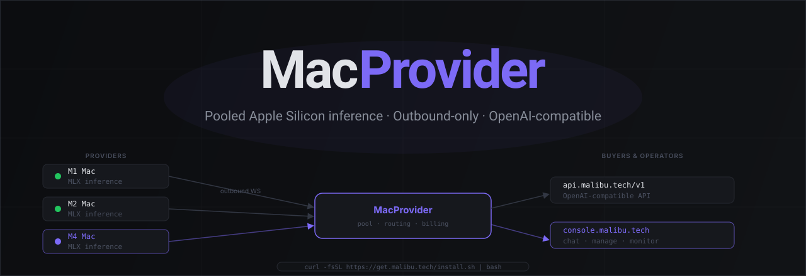

<p align="center">
  
</p>

<p align="center">
  <a href="https://console.malibu.tech"><strong>Console</strong></a> &middot;
  <a href="https://portal.malibu.tech"><strong>Provider Portal</strong></a> &middot;
  <a href="https://api.malibu.tech/docs#api-reference"><strong>API Docs</strong></a> &middot;
  <a href="https://github.com/augustas11/macprovider/releases"><strong>Releases</strong></a>
</p>

<p align="center">
  
  
  
  
</p>

# MacProvider

MacProvider is a pooled inference network built on Apple Silicon. Mac owners
run a small provider (`macprovider-cli`, or the Malibu menu-bar app) that serves
MLX models and earns for the work; developers call the pool through an
OpenAI-compatible API at `api.malibu.tech`. Provider Macs only dial out over a
WebSocket, so they need no open ports, and every response can carry a signed
receipt that buyers verify themselves.

The project includes the provider CLI and Malibu macOS app, the coordinator, the
buyer gateway, receipt verification tooling, web front ends, signed release
automation, operational runbooks, and the normative SPEC corpus that governs the
wire contracts.

## What It Provides

| For providers | For buyers |
|---|---|
| Serve MLX models from any M1+ Mac | Use `/v1/chat/completions` with OpenAI SDKs |
| No inbound ports; the Mac dials out to the coordinator | Route to the live pool or a pinned provider |
| Installer-integrated model recommendation and release verification | Streaming, tool calling, structured output, and sticky sessions |
| Provider portal for setup, identity, status, and earnings | Signed receipt verification with `macprovider-verify` |

## Architecture

```text
Provider Mac
  macprovider-cli + mlx-lm
        |
        | outbound WebSocket
        v
Coordinator
  provider pool, routing, billing ledger, trust gates
        |
        | loopback buyer API
        v
Gateway
  API keys, quotas, OpenAI-compatible /v1 surface
        |
        +--> https://api.malibu.tech/v1
        +--> https://console.malibu.tech
        +--> https://portal.malibu.tech
```

Prompts and responses pass through the gateway and coordinator for routing,
billing, and receipt handling. Model weights stay on provider Macs. A valid
MacProvider receipt proves a provider signing key signed the canonical tuple; it
does not prove model honesty, hardware attestation, privacy, or that a provider
could not falsify its own measurement.

## Provider Quickstart

Run the public installer on Apple Silicon macOS 14+:

```bash
curl -fsSL https://get.malibu.tech/install.sh | bash
```

The installer downloads the signed release asset, verifies the checksum
manifest, installs under `~/macprovider`, configures a user-level launchd
service, runs local and coordinator visibility checks, and enrolls the provider
in the autoupdate path.

For SSH-only Mac mini fleets, use the headless install profile instead:

```bash
MACPROVIDER_HEADLESS=1 bash install.sh
```

See the [headless Mac mini runbook](docs/runbooks/headless-mini-productization.md)
for install, reboot persistence, signed-bundle upgrade, and uninstall.

Useful provider commands:

```bash
malibu-cli status
malibu-cli models list
malibu-cli models switch <model-id>
malibu-cli autotune
malibu-cli update
```

Provider implementation details live in [phase3-binary/](phase3-binary/).
Production operations live in [ops/runbooks/](ops/runbooks/) and [docs/runbooks/](docs/runbooks/).

## Buyer Quickstart

Base URL:

```text
https://api.malibu.tech/v1
```

Python example:

```python
from openai import OpenAI

client = OpenAI(
    base_url="https://api.malibu.tech/v1",
    api_key="<your-macprovider-api-key>",
)

response = client.chat.completions.create(
    model="mlx-community/Llama-3.2-3B-Instruct-4bit",
    messages=[{"role": "user", "content": "Hello from Malibu"}],
)

print(response.choices[0].message.content)
```

Get an API key at
[api.malibu.tech/auth/github/start](https://api.malibu.tech/auth/github/start).
Worked SDK examples are in
[docs/using-macprovider-with-openai-sdk.md](docs/using-macprovider-with-openai-sdk.md).

## Local Consumer Endpoint

`malibu-cli consume` can run a loopback-only local OpenAI-compatible
endpoint for tools that expect a local `/v1` server. It keeps the upstream buyer
credential in local custody and gives local clients a per-run bearer token.

```bash
malibu-cli consume run \
  --credential-file ~/.config/macprovider/buyer-api-key \
  --allow-model mlx-community/Llama-3.2-3B-Instruct-4bit \
  --budget-usd 5
```

By default it binds `127.0.0.1:11435`, rejects non-loopback listeners, supports
`GET /v1/models`, `POST /v1/chat/completions`, and `GET /v1/status`, and keeps a
local exposure ledger. The contract is tracked in
[SPEC-045](specs/SPEC-045-local-consumer-endpoint-mode.md).

## Implemented Capabilities

- OpenAI-compatible buyer gateway: chat completions, streaming, status, usage,
  API keys, quotas, and feedback.
- Provider WebSocket coordinator: pool admission, model identity, failover,
  canary/warmup gates, billing ledger, and operator endpoints.
- Signed inference receipts and settlement-aware receipt verification
  ([SPEC-015](specs/SPEC-015-receipts.md),
  [SPEC-022](specs/SPEC-022-verified-model-settlement.md)).
- Tool calling and structured output transport
  ([SPEC-018](specs/SPEC-018-agentic-tool-calling.md),
  [SPEC-019](specs/SPEC-019-structured-output.md)).
- Sticky conversations and provider-local KV-cache accounting
  ([SPEC-024](specs/SPEC-024-prefix-cache-billing.md)).
- Signed installer/autotune recommendation feed and provider autoupdate
  ([SPEC-020](specs/SPEC-020-provider-autoupdate.md),
  [SPEC-023](specs/SPEC-023-installer-autotune-recommend.md)).
- Malibu provider app, console, provider portal, and trusted-pool creator flows.

The generated spec index in [specs/README.md](specs/README.md) is the best
current map of normative and draft surfaces.

## Repository Layout

| Path | Purpose |
|---|---|
| [`phase3-binary/`](phase3-binary/) | Swift provider CLI, Malibu app, installer, model catalog, and release tooling |
| [`phase4-coordinator/`](phase4-coordinator/) | Go coordinator: provider pool, routing, billing ledger, auth, operator APIs |
| [`phase5-gateway/`](phase5-gateway/) | Go buyer gateway: API keys, quotas, the OpenAI-compatible `/v1` surface |
| [`phase7-verify/`](phase7-verify/) | `macprovider-verify` receipt verifier CLI and schemas |
| [`frontdoor/`](frontdoor/) | Console and provider portal web front ends |
| [`specs/`](specs/) | Normative SPEC documents, `AUTHORITY.json`, and `CONFORMANCE.json` |
| [`journeys/`](journeys/) | End-to-end journey definitions and their signed evidence |
| [`schemas/`](schemas/) | JSON schemas for release, journey, and governance artifacts |
| [`security/`](security/) | Public signing keys and keyrings that releases are verified against |
| [`docs/`](docs/) | Guides, runbooks, design notes, research, reports, and the decision log |
| [`ops/`](ops/) | Production operations scripts, exception register, and runbooks |
| [`scripts/`](scripts/) | Release, governance, pricing, test, and CI helper scripts |
| [`test/`](test/), [`testdata/`](testdata/) | Integration harnesses, e2e checks, and fixtures |
| [`examples/`](examples/), [`tools/`](tools/) | SDK examples and pinned tool versions |

Local-only scratch work, editor state, orchestration logs, secrets, build
outputs, and generated runtime artifacts are intentionally excluded from the
tracked tree.

## Development

Clone the repo, then run the smallest test that covers the surface you are
changing. Common gates:

```bash
make test
make vet
cd phase3-binary && swift test
cd phase4-coordinator && go test ./...
cd phase5-gateway && go test ./...
cd phase7-verify && go test ./...
python3 scripts/gen_spec_index.py --check
python3 scripts/check_spec_governance.py
```

See [CONTRIBUTING.md](CONTRIBUTING.md) for the build, test, and pull request
workflow, including the SPEC governance declaration every PR carries. The full
repository manual for human and agent contributors is [AGENTS.md](AGENTS.md).

## Security

Never commit API keys, private keys, payout keys, `.env` files, buyer prompts,
provider tokens, or receipt bundles with private contents. Report security
issues privately as described in [SECURITY.md](SECURITY.md).

Buyer-side frameworks must validate tool calls before execution. MacProvider
transports model output in an OpenAI-compatible shape; it does not decide
whether a tool name or argument payload is safe for an agent policy.

## Engineering Records

Historical engineering records (Phase 1 PoC reports, audit rounds, beta-program
notes, session handoffs, and raw lab evidence) live in a private archive that
mirrors this repository's layout. Specs and docs that cite paths such as
`audits/...`, `beta/...`, `docs/legacy/phase1/...`, or `docs/handoffs/...`
refer to that archive. Evidence that code or `specs/CONFORMANCE.json` reads is
kept in this repository.

## License

MacProvider is released under the [MIT License](LICENSE).
